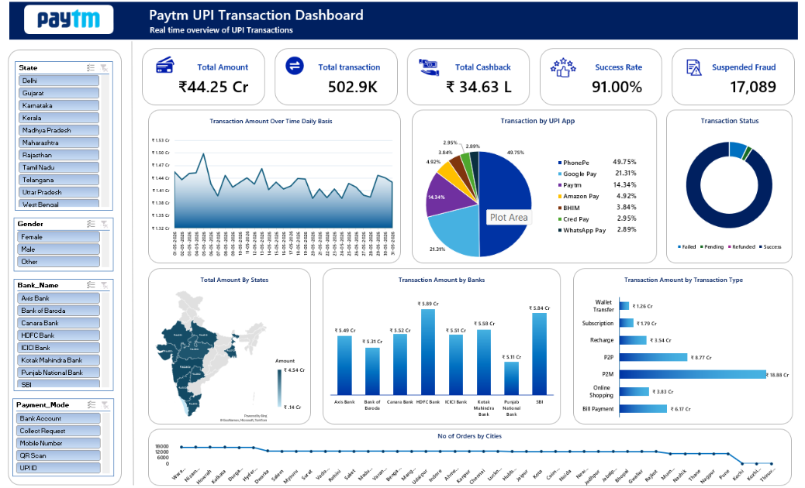

# 📊 Paytm UPI Transaction Dashboard

An interactive dashboard that analyses Paytm UPI transaction data and gives a real-time overview of transaction value, volume, cashback, success rate and fraud across states, banks, UPI apps, payment modes and cities.



> 📌 Add your dashboard screenshot in the repository as `dashboard-preview.png` so the image above shows up.

---

## 📖 Project Overview

UPI has become the backbone of digital payments in India. This project analyses Paytm UPI transactions to understand:

- How much money is moving and how many transactions are happening
- Which UPI apps, banks and states drive the most transactions
- How reliable the system is (success vs. failed / pending / refunded)
- How much cashback was given and how many cases of suspected fraud were flagged
- Which transaction types and cities contribute the most

The dashboard is meant to help business and operations teams monitor performance and take data-driven decisions.

---

## 🎯 Objectives

- Build a clean, interactive dashboard for UPI transaction monitoring
- Track key KPIs at a glance
- Identify trends in daily transaction amounts
- Compare performance across banks, UPI apps, states, cities and transaction types
- Monitor transaction success rate and fraud cases

---

## 📌 Key KPIs

| KPI | Value |
|---|---|
| 💰 Total Amount | ₹44.25 Cr |
| 🔁 Total Transactions | 502.9K |
| 🎁 Total Cashback | ₹34.63 L |
| ✅ Success Rate | 91.00% |
| 🚨 Suspected Fraud | 17,089 |

---

## 📈 Dashboard Visuals

| Visual | What it shows |
|---|---|
| **Transaction Amount Over Time (Daily)** | Daily trend of transaction value for May 2026 |
| **Transaction by UPI App** | Market share – PhonePe (49.75%), Google Pay (21.31%), Paytm (14.34%), Amazon Pay (4.92%), BHIM (3.84%), Cred Pay (2.95%), WhatsApp Pay (2.89%) |
| **Transaction Status** | Split of Success, Failed, Pending and Refunded transactions |
| **Total Amount by States** | Map showing state-wise transaction value |
| **Transaction Amount by Banks** | Comparison across Axis, Bank of Baroda, Canara, HDFC, ICICI, Kotak Mahindra, PNB and SBI |
| **Transaction Amount by Transaction Type** | Wallet Transfer, Subscription, Recharge, P2P, P2M, Online Shopping, Bill Payment |
| **No. of Orders by Cities** | City-wise order count |

### 🎛️ Slicers (Filters)

- **State**
- **Gender**
- **Bank Name**
- **Payment Mode** (Bank Account, Collect Request, Mobile Number, QR Scan, UPI ID)

---

## 🔍 Key Insights

- **P2M (Person-to-Merchant)** is the largest transaction type at about **₹18.88 Cr**, followed by **P2P (₹8.77 Cr)** and **Bill Payment (₹6.17 Cr)**.
- **PhonePe** leads UPI app usage with almost **half (49.75%)** of all transactions, followed by Google Pay.
- **HDFC Bank (₹5.89 Cr)** and **SBI (₹5.84 Cr)** handle the highest transaction value among the banks.
- The overall **success rate is 91%**, which means roughly 9% of transactions fail, stay pending or get refunded – an area for improvement.
- Daily transaction amount stays in a fairly stable range with a few visible spikes and dips.

---

## 🛠️ Tools & Technologies

- **Microsoft Excel** – data cleaning, Pivot Tables, Pivot Charts, Slicers, Maps
- **Data Cleaning & Transformation** – handling missing values, duplicates, formatting
- **Data Visualization** – KPI cards, line, pie, donut, bar and map charts

---

## 📂 Repository Structure

```
Paytm-UPI-Transaction-Dashboard/
│
├── data/
│   └── paytm_upi_transactions.csv     # Dataset (add your data file)
├── Paytm_UPI_Dashboard.xlsx           # Dashboard workbook
├── dashboard-preview.png              # Dashboard screenshot
└── README.md                          # Project documentation
```

> Update the file names above to match the files you actually upload.

---

## ⚙️ How to Use

1. Clone this repository
   ```bash
   git clone https://github.com/sujalnandanwar/Paytm-UPI-Transaction-Dashboard.git
   ```
2. Open the dashboard workbook in **Microsoft Excel**
3. Use the slicers (State, Gender, Bank Name, Payment Mode) to filter the data
4. Explore the charts – all visuals update as per the selected filters

---

## 🔄 Project Workflow

1. **Data Collection** – UPI transaction dataset
2. **Data Cleaning** – removed duplicates, fixed data types, handled blanks
3. **Data Modelling** – created Pivot Tables and calculated KPIs
4. **Visualization** – built charts, KPI cards and map
5. **Interactivity** – added slicers for dynamic filtering
6. **Insights** – analysed patterns and summarised findings

---

## 🚀 Future Improvements

- Connect to a live data source for real-time refresh
- Rebuild the dashboard in **Power BI** with DAX measures
- Add fraud-pattern analysis and time-of-day trends
- Add month-over-month and year-over-year comparison

---

## 👤 Author

**Sujal Manoj Nandanwar**
BCA Student | Aspiring Data Analyst

- 📧 Email: sujalnandanwar2@gmail.com
- 💼 LinkedIn: [linkedin.com/in/sujalnandanwar](https://linkedin.com/in/sujalnandanwar)
- 🐙 GitHub: [github.com/sujalnandanwar](https://github.com/sujalnandanwar)

---

⭐ If you found this project useful, please give it a star!
